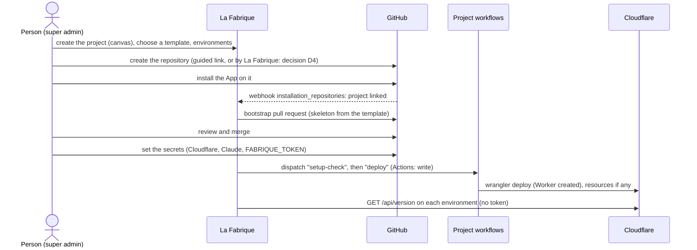

# Epic F8 — Start a project from scratch (scoping draft)

November 7, 2026 · draft for the owner · number to confirm · from card C52 (*Onboard new / empty project*)

> Status: **scoping**. The epic format is still being defined; this document gathers the need, the decisions to take, and the stories to write. Once the decisions are taken, the stories become cards (then issues), and C52 becomes the epic's card.

## Why

Today La Fabrique pilots a project only once it exists: a GitHub repository, the App installed on it, a `.fabrique.json`, workflows, a hosting that answers `/api/version`. Everything before that is done by hand, outside La Fabrique, and La Fabrique's own setup (`docs/owner-setup.md`) shows how long it is: Cloudflare resources, secrets, GitHub App, webhooks, first deploy.

Yet the upstream is exactly what La Fabrique is for (principle 1): a project starts as an idea and a few cards, long before it has code. We want to:

- **create a project in La Fabrique as a blank canvas**: a name, a board, cards. No architecture, no GitHub, no branch, no online version;
- **choose its architecture from a template** (at first, what La Fabrique and the épicerie already use: GitHub and Cloudflare Workers), and change it later from the Architecture page;
- **declare its environments**: at least one, which is not necessarily production;
- **automate the creation of what it runs on**, as far as the principles allow: the GitHub repository (private or public, and its options), then a basic Cloudflare Worker, without a domain name, with the minimum security from day one.

## What exists today, and what assumes a repository

| Today | Where | What it means for a project from scratch |
|---|---|---|
| A project **is** a repository: `projects.repo` (`owner/name`) is the key, `installation_id` is required | `migrations/0003_projects.sql`, `src/projects.ts` | A project without a repository cannot exist. |
| Every project table (cards, sprints, log, snapshots…) is keyed by `repo`, and every page lives under `/projects/{owner}/{name}` | 12 migrations, `src/urls.ts` | The key must be known from the start, or replaced. |
| *Add a project*: pick a repository where the App is installed | `/projects/new`, `src/project-routes.ts` | Nothing to pick yet. C50 improves this page for existing repositories. |
| The project describes itself in `.fabrique.json` (principle 2), read at the commit | `src/fabrique-config.ts`, `docs/fabrique-json.md` | Before the repository exists, there is no file to read. |
| *Setup* lists what is missing and proposes changes as pull requests | `src/setup.ts`, `src/config-change.ts` | The natural checklist for the bootstrap, once a repository exists. |
| Environments: `type` is `integration` or `production` | `ENVIRONMENT_TYPES` | A single environment of type `integration` (no production yet) must stay valid. |
| The stack is implicit (GitHub, Cloudflare, TypeScript) | — | C26 (F6.1) declares it; templates write it. |
| Components are self-described folders read from the repository | F6.3, `src/components.ts` | A template brings its components (report kit, release notes) with their `origine`. |
| The App's permissions are minimal: no administration, no secrets | `CLAUDE.md` > Architecture | Creating a repository, setting rulesets or secrets needs more, or needs the person. |
| La Fabrique never holds a deployment token (principle 3) and never writes directly on a project's branch | `CLAUDE.md` > Principes | Cloudflare is created by the project's own workflow; the first files arrive by a pull request. |

## The journey

A project goes through stages. Each one is visible on its page and in its log; it can stay at any stage as long as it needs (a project may live for weeks as cards only).

```
0. Canvas        name, description, language · board and cards work · nothing else
1. Architecture  a template chosen: stack, branches, workflows, components (editable)
2. Environments  at least one: name, type, branch, address (deduced)
3. Repository    created on GitHub, App installed, linked to the project
4. Bootstrap     a pull request with the skeleton; merged by the person
5. Secrets       set by the person, checked by a workflow of the project
6. First deploy  the project's workflow creates the Worker(s); /api/version answers
7. Piloted       Setup is green: the project is like the others
```

Stages 0 to 2 live only in La Fabrique (a **blueprint**). From stage 3, the repository is the source: the blueprint becomes the first `.fabrique.json` and is no longer edited in La Fabrique, only through pull requests, like any project.



## Decisions to take (proposals)

Each decision is a proposal for the owner; the stories depend on them.

### D1. A project exists before its repository

**Proposal:** keep `owner/name` as the project's key, chosen at creation as the **intended** repository; `installation_id` becomes optional and the project has a `state` (`canvas`, `linked`). Until the repository is created, the name can change (a rename rewrites the key in every table: little data at that stage, done in one transaction and logged). Once linked, it is the repository's name, as today.

Alternative: a project id independent of the repository (a slug), with `repo` as an attribute. Cleaner in the long run (a repository moved or renamed, another provider than GitHub), but it touches every table, route and the MCP. To weigh against F6's "another provider" horizon; not needed for this epic.

### D2. The blueprint lives in La Fabrique until the repository exists

Principle 2 says a project describes itself in its own repository. Before there is one, La Fabrique keeps a **draft `.fabrique.json`** (with its `stack`, environments, workflows) in its own base, versioned like a card. It is checked with the same validator (`validateFabriqueConfig`), so what will be committed is already valid. At stage 4 it is committed by the bootstrap pull request; from then on La Fabrique reads the repository's file and the draft is kept read-only in the history. Nothing project-specific enters La Fabrique's code.

### D3. Templates

A template is a starting point, not a framework: once the project is created, its files are the project's own.

**Proposal:** templates are folders of La Fabrique's own repository, `templates/<id>/`, described by a `template.json` and read like components (F6.3): what it is for, the `stack` values it writes (C26), its environment layout, its workflows, its components, and the skeleton files (with placeholders: name, URLs, language). Two templates at first, taken from what exists:

| | **Single environment** (like La Fabrique) | **Integration and production** (like the épicerie) |
|---|---|---|
| Branches | `main` only; work on `claude/*`, `feature/*` | `integration` and `main`; `main` receives `integration` at the go |
| Environments | 1 (type `production`, or `integration` while nothing is public) | 2: `int` (`integration`), `production` |
| Testing (`recette`) | the single environment | `int` |
| Workflows | `ci`, `deploy`, `claude`, `merge` (`fusionner`), `release` (`publier`) | `ci`, `deploy-int`, `deploy` (production), `claude`, `promouvoir` |
| Release notes | `docs/release-notes.json`, `0.N`, numbered at merge | entries without time on `integration`, one version at the go |
| Hosting | one Cloudflare Worker on `workers.dev` | two Workers (`<name>-int`, `<name>`) on `workers.dev` |
| Data | none by default; D1 as an option | none by default; D1 as an option (one base per environment) |
| Components | release notes; report and test kit (`origine`: La Fabrique, version) | same |

The skeleton is minimal: `README.md`, `CLAUDE.md` (seeded from the canvas, see D8), `.fabrique.json`, `wrangler.jsonc`, a Worker that answers a page and `/api/version` with the security headers and a strict CSP, `docs/release-notes.json`, the workflows, `.gitignore`, a licence if chosen.

**Changing the architecture.** Before the repository exists: freely, from the Architecture page (C27 in a "planned" mode): another template, another value of a capability. After: the Architecture page describes, and a change goes through a pull request from Setup, like the lifecycle today. Moving an existing project from one template to the other (adding an integration branch, for instance) is a later story.

Later: templates in catalogue repositories, templates shared between organisations, other stacks (GitLab, AWS, Postgres…: F6 says describe first, adapters only when asked).

### D4. Creating the GitHub repository: how much automation

The App has no *Administration* permission, on purpose. Three levels:

- **L0, guided (no new permission).** La Fabrique prepares everything and the person clicks: a link to `github.com/new` with the owner, name, description and visibility prefilled (and *Add a README*, so the repository has a `main` branch: see D5), then the App's installation link for that repository. A webhook (`installation_repositories`) tells La Fabrique the App is on it: the project moves to `linked` by itself.
- **L1, created by La Fabrique in the person's name.** `POST /user/repos` or `/orgs/{org}/repos` with the person's user token: needs the App's *Administration: write* permission (to verify), and the App installed on *all repositories* of the account, or an extra step to add the new one to the installation. The person still needs the right to create repositories in that owner.
- **L2, from a template repository** (`POST /repos/{template}/generate`): GitHub copies a template repository. Would make La Fabrique's templates GitHub repositories, not folders (contradicts D3), same permission question.

**Proposal:** L0 first (one story), L1 behind an explicit decision on the App's permissions, after a spike that checks on a test account what each endpoint really requires.

Options offered at creation (L0 prefills what GitHub accepts in the link, the rest becomes a checklist; L1 sets them all):

- owner (the person, or an organisation where the App is installed), name, description;
- visibility: **private by default**; public as a choice (secret scanning and push protection are free on public repositories);
- licence (none by default; Apache-2.0 like La Fabrique as a suggestion), `.gitignore` from the template;
- merge settings: squash only, branch deleted after merge, *Allow GitHub Actions to create pull requests* (needed by `claude`);
- issues on, wiki and projects off;
- the labels of the circuit (`request`, `ready-for-claude`, `to-validate`, `rework`, priorities): created by La Fabrique with *Issues: write*, which it already has.

### D5. The first files arrive by a pull request

An empty repository has no branch, so no pull request can be opened on it. **Proposal:** keep the principle (La Fabrique never writes directly on a project's branch) and require the repository to start with a README (L0: ticked by the person; L1: `auto_init`). La Fabrique then opens the **bootstrap pull request** on `main` in the person's name, with the skeleton of the template filled in. The person reviews and merges it.

For the two-environment template, the `integration` branch is created after the merge by a workflow of the project (`setup-check`, `GITHUB_TOKEN` with *contents: write*), not by La Fabrique.

### D6. Secrets stay with the project

Principle 3: La Fabrique never holds a deployment token. A new project needs, as GitHub Actions secrets: `CLOUDFLARE_API_TOKEN`, `CLOUDFLARE_ACCOUNT_ID`, `CLAUDE_CODE_OAUTH_TOKEN` or `ANTHROPIC_API_KEY`, and `FABRIQUE_TOKEN` (fine-grained, this repository only). **Proposal:**

- Setup shows the list for the template, why each is needed, how to create it (the exact scopes, see "Minimum security") and the `gh secret set` commands to run, as the *Connected app* page does for its secret.
- La Fabrique cannot read secret names without the *Secrets* permission. A `setup-check` workflow of the project (dispatched by La Fabrique, *Actions: write*, which it has) checks that each expected secret is set and usable (Cloudflare: `wrangler whoami`; never printing a value) and writes the result as the run's summary, that La Fabrique reads.
- Later, as an option: a form in La Fabrique that encrypts each secret **in the browser** with the repository's public key (sealed box) and posts only the ciphertext. La Fabrique would never see the value, but the App would need *Secrets: write*. To decide with D4.

### D7. Cloudflare is created by the project's own workflow

La Fabrique has no Cloudflare token and asks for none. **Proposal:** the template's `deploy` workflow creates what it needs on its first run, with the project's secrets: `wrangler deploy` creates the Worker on `workers.dev`; an optional D1 base is created by the workflow (`wrangler d1 create` if missing) and its id kept where the workflow finds it again (to settle in the story: committed by a pull request of the workflow, or resolved by name at each deploy). La Fabrique dispatches the workflow and then reads `/api/version` on each environment, without a token, as today.

Without a domain name, each environment's address is deduced: `https://<worker>.<account-subdomain>.workers.dev`. The account subdomain is not known to La Fabrique; the first deploy's summary gives it, and La Fabrique proposes the `url` of each environment in `.fabrique.json` by a pull request (or the person types it).

### D8. Claude's part

- **Before the repository** (stages 0–2): Claude in La Fabrique (its own key, its quotas) can write the canvas's vision card and the first `CLAUDE.md` of the project from its cards. Only La Fabrique's text leaves for Anthropic: there is no code yet, principle 3 holds.
- **After the bootstrap**: everything else is done by the project's own `claude` workflow, like any story. The natural first story of a new project is its own home page.

### D9. Who may create a project, and when it is "done"

- Creating a project is managing projects: **super admin**, as *Add a project* today. With F4.9 (#84, roles per project) the creator becomes the project's first Product Engineer or tech lead, and C8 (invite a user on a project with a role) completes it. Until then, roles stay global.
- **Done** = stage 7: the repository is linked, `.fabrique.json` is valid, the expected secrets are checked, each environment answers `/api/version` with its type, the workflows La Fabrique triggers are declared. Setup says it, step by step; the log keeps who did each step and when.

## Minimum security of a new project

What the template and the checklist bring from day one. Each line is either **in the skeleton** (code, reviewed in the bootstrap PR), **checked** by `setup-check`, or **guided** (the person does it on GitHub or Cloudflare, Setup says how and whether it is done).

**GitHub**

- Private by default. *(guided / L1)*
- A ruleset on the production branch (and `integration`): pull request required, CI green, no force push, no deletion. Needs *Administration*: guided at L0. *(guided)*
- Secret scanning and push protection (free on public repositories; on private ones, depends on the plan). Dependabot alerts and security updates. *(guided)*
- Workflows: `permissions:` declared per job (read-only by default), actions pinned to a version, `GITHUB_TOKEN` read-only by default in the repository's settings. *(skeleton, guided for the setting)*
- `FABRIQUE_TOKEN`: fine-grained, this repository only, *Contents*, *Pull requests*, *Issues* in write, with an expiry date. *(guided, checked)*
- No secret in the code or in `vars` (the skeleton's `.gitignore` covers `.dev.vars`, `.env`). *(skeleton)*

**Cloudflare**

- An API token for this project only: one account, *Workers Scripts: Edit* (plus *D1: Edit* or *Queues: Edit* only if the template uses them); no zone permission (no domain); an expiry date; optionally restricted to GitHub Actions' IP ranges. *(guided, checked)*
- `workers.dev` only; **preview URLs off** (`preview_urls: false`) so unreviewed versions are not public; `global_fetch_strictly_public`; observability on. *(skeleton)*
- The Worker answers with the security headers (HSTS, `X-Content-Type-Options`, `Referrer-Policy`, `frame-ancestors 'none'`) and a strict CSP (`script-src 'self'`, no inline script, no `eval`), like La Fabrique. *(skeleton)*
- Secrets of the Worker by `wrangler secret put`, never in `wrangler.jsonc`. `/api/version` answers only the version, the environment and the deployment id. *(skeleton)*
- A non-production environment says so (`environnement` in `/api/version`), and is not indexed (`X-Robots-Tag: noindex`). *(skeleton)*

## Stories (proposed)

To be written as cards once the decisions are taken. Suggested order: F8.1 → F8.5 gives a project that exists on GitHub with its files; F8.6 → F8.8 makes it run; F8.9 is the automation step.

| | Story | Depends on | Related |
|---|---|---|---|
| F8.1 | **A project before its repository**: create a canvas (name, intended `owner/name`, description, language); board, cards, Claude on cards work; rename while not linked; the projects list shows its stage | D1 | C52, F4.9 #84 |
| F8.2 | **Choose a template**: the two templates, what each brings; the blueprint (draft `.fabrique.json`) checked by the validator; change it while not linked | D2, D3, F6.1 | C26, C27, F6.3 #197 |
| F8.3 | **Declare the environments**: one at least, not necessarily production; name, type, branch, testing environment, who may report; format: a project whose only environment is `integration` stays valid (no go until a production exists) | D2 | `docs/fabrique-json.md`, F6.6 #209, F6.7 #210 |
| F8.4 | **Create the repository, guided (L0)**: prefilled GitHub link, App installation link, linked by the `installation_repositories` webhook; the circuit's labels created | D4 | C50 (same App explanation and installation table) |
| F8.5 | **The bootstrap pull request**: the template's skeleton filled in, components copied with their `origine`, `CLAUDE.md` seeded; opened in the person's name on `main` | D3, D5, D8 | F6.3, C29 |
| F8.6 | **Secrets, guided and checked**: the list per template with scopes and commands; the `setup-check` workflow and its summary in Setup | D6 | `docs/owner-setup.md` §2, §10 |
| F8.7 | **First deploy**: La Fabrique dispatches the project's `deploy`; the Worker(s) created on `workers.dev`; addresses proposed by PR; Setup shows each environment answering | D7 | Setup, Production |
| F8.8 | **Minimum security, step by step**: the checklist above in Setup, each line done, to do (with how) or not applicable | — | C46 (webhooks in Setup) |
| F8.9 | **Repository created by La Fabrique (L1)**, and optionally secrets encrypted in the browser: only if the owner extends the App's permissions | D4, D6 | — |

### Links with existing work

- **C52** *Onboard new / empty project* (draft): becomes this epic's card.
- **C50** *Onboard existing GitHub project* (shaping): shares the App explanation, the installation table, and stages 5–8 (secrets, deploy, security, Setup green). Its open question "where does the code analysis run" does not arise here (no code yet); the two epics should share one Setup checklist.
- **C26 / F6.1** *A project's stack, declared*: a template **writes** the `stack` section; its list of capabilities and known values is what the template chooses from. Needed before F8.2.
- **C27 / F6.2** *The Architecture page*: shows the planned stack of a canvas (editable before the repository), then the real one (read-only, changes via Setup).
- **F6.3** (#197, components read) and **C29 / F6.4** (#249–#254, make a component): a template's components are copied into the new project with their `origine`; the report kit and the release notes are the first.
- **F2.3** *Architecture space* (#21): answered by F6.1 and F6.2; can be closed once they ship.
- **F4.9** *Roles per project* (#84) and **C8** (invite a user on a project with a role): who works on the new project.
- **C46** *Webhooks in Setup*: the new `installation_repositories` event, and the check that the App's webhook reaches La Fabrique.

## Out of scope (for now)

- A domain name, DNS, custom routes; e-mail, OAuth providers of the project (Google…).
- Other providers than GitHub and Cloudflare (F6: describe first, adapters only when asked).
- A mobile app, a data pipeline, paid-plan resources by default.
- Moving an existing project from one template to another.
- Templates shared between organisations, catalogue repositories.
- Deleting a project's repository or Worker from La Fabrique (never: La Fabrique does not destroy what the project owns).

## Open questions for the owner

1. **D1**: keep `owner/name` as the key from the canvas on (renamable until linked), or introduce a project id now?
2. **D4**: is L0 (guided links, no new permission) enough for a first version? Is extending the App with *Administration: write* acceptable later, or do we stay guided for good?
3. **D6**: secrets set by the person with commands, or worth the *Secrets: write* permission for an in-browser encrypted form?
4. **Single environment that is not production**: type `integration` (no go, no production yet), or a new type (`preview`, `staging`)? What happens the day a production is added: a story of its own?
5. **Templates**: folders in La Fabrique's repository (proposal), or GitHub template repositories? Who maintains them, and does a template carry a version so Setup can propose updates like the kit?
6. **Data by default**: D1 opt-in, or the single-environment template with D1 like La Fabrique?
7. **Owners**: personal accounts only at first, or organisations too (the App installed on the organisation)?
8. **Who** may create a project: super admin only, or a Product Engineer once roles are per project?
9. **Claude before the repository**: should Claude in La Fabrique write the first `CLAUDE.md` and the vision card (La Fabrique's key and quotas), or is that the project's first story?
